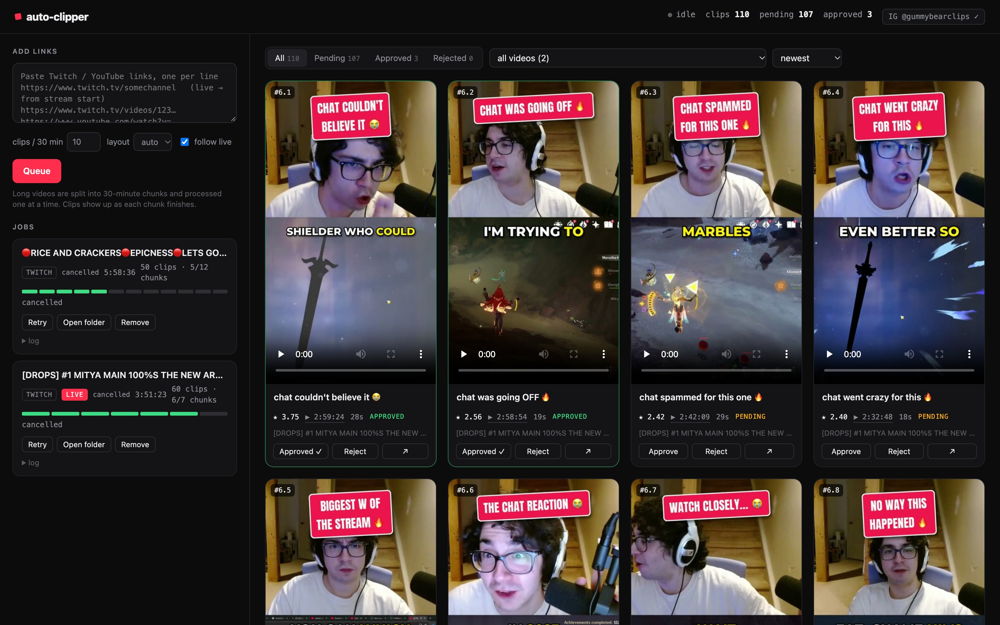
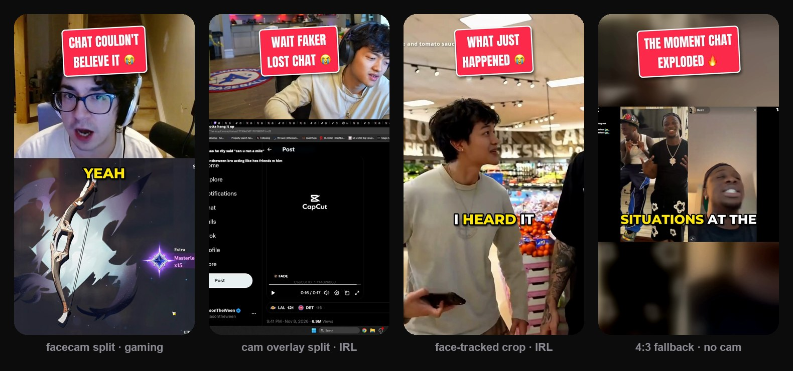
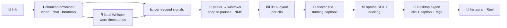

<div align="center">

# 🍬 Auto-Clipper

### Paste a Twitch or YouTube link. Get ranked, captioned, ready-to-post 9:16 shorts.

**Fully local · no LLM · no cloud · built for stream clippers**




</div>

---

## ✨ What it does

Drop in a **Twitch VOD, a live Twitch channel, or a YouTube video** and Auto-Clipper:

1. **Downloads** it in 30-minute chunks (parallel HLS, ~10 MB/s) along with the **chat replay** and YouTube's *most-replayed* heatmap
2. **Transcribes** it locally with word-level timestamps (faster-whisper + Silero VAD)
3. **Scores every second** of the stream from chat velocity, emote spam, "CLIP IT" mentions, loudness, yelling, hype keywords, speech density and on-screen action
4. **Cuts the best moments** with build-up before the peak and payoff after, snapped to natural pauses
5. **Re-frames to 9:16** automatically: facecam-on-top split for gaming, face-tracked crop for IRL, smart fallback when there's no cam
6. **Burns in captions**: a tilted *sticker* hook title (🔥 or 😭) plus word-by-word running captions with the current word highlighted
7. **Adds sparse SFX**: an outro sting plus a hit on the biggest peak, with the stream audio ducked underneath. Weaker clips (score < 2) also get a **quiet CC-licensed music bed** matched to the mood, which dips whenever someone speaks
8. **Exports** every clip to a Desktop folder with a ready-to-paste **caption + hashtags** for Instagram and YouTube Shorts
9. Optionally **publishes to Instagram** as a Reel through the official Graph API

<div align="center">

<sub>Real output: one pipeline, four layouts, picked automatically per clip.</sub>
</div>

### 🎬 Live examples
Posted straight from the pipeline to [@gummybearclips](https://www.instagram.com/gummybearclips/):
[gacha pull 🔥](https://www.instagram.com/reel/DfjsVefCHa_/) ·
[grocery run 😭](https://www.instagram.com/reel/DfjshQaCEk7/) ·
[chat lost it 😭](https://www.instagram.com/reel/DfjrfZxiISP/)

---

## 🧠 How it works



### Scoring, with no LLM

Every signal becomes a per-second series. Each one is robust-z-normalised, smoothed, and combined with tunable weights:

| Signal | Source | Why it works |
|---|---|---|
| **Chat velocity** | Twitch chat replay (shifted for chat lag) | the strongest hype detector on Twitch |
| **Emote density** | KEKW · LUL · Pog · W · `?????` · caps ratio | *how* chat reacted, not just how much |
| **"Clip it" mentions** | chat | close to a human-labelled highlight |
| **Loudness jumps + spectral flux** | audio | shouting, sudden noise |
| **Yelling / laughing** | voice-band energy × brightness | reactions |
| **Hype keywords** | transcript ("no way", "let's go", …) | spoken excitement |
| **Speech density** | transcript | fast talking = hype |
| **Most-replayed** | YouTube heatmap | the audience literally voted |
| **Visual activity** | frame-diff | action on screen |

Moments where the streamer's cam disappears (starting soon / BRB screens) are down-weighted automatically.

### Smart 9:16 layouts

Face detection (YuNet) runs on frames sampled from **each clip**, because streams change scenes constantly:

- **Facecam overlay found** → the overlay's exact border is detected (edges that stay put across frames), the cam goes on top and the gameplay below, cropped to avoid the cam
- **On-camera / IRL** → a 9:16 crop that follows the face
- **Small faces in content, or none** → 4:3 frame on a blurred background, so nothing important gets cropped away

### Titles that hook

Built from heuristics only: the dominant chat reaction (`KEKW` spam → *"chat lost it 😭"*), a shouted line from the transcript, or a varied template. Titles never repeat within a chunk and always end in 🔥 (hype) or 😭 (funny / chaos).

---

## 🖥️ The dashboard

`clipper ui` opens a local web app at `http://localhost:8765`:

- **Paste links** (several at once), set clips per 30 min, pick a layout, follow live streams
- **Job cards** with per-chunk progress bars, a LIVE badge, logs, cancel (stops within seconds), retry and *open folder*
- **Clip grid** with thumbnails, an inline player, scores, a ▶ deep link to the exact moment in the stream, and click-to-edit titles that re-render on Enter
- **Post ▸ IG** on any clip publishes it as a Reel in about 30 s; posted clips get a badge linking to the Reel
- **Auto-post campaigns**: *"post 50 clips from this stream, one every 5 minutes, most viral first"*. Strong clips from chunks rendered later still jump the queue, and it pauses itself if Instagram pushes back
- **Connect Instagram** with one click (OAuth, permanent Page token)

---

## 🚀 Quickstart

```bash
git clone https://github.com/gummybearansh/Auto-Clipper.git && cd Auto-Clipper
uv venv --python 3.11 .venv
uv pip install --python .venv -e .
brew install ffmpeg          # any ffmpeg works; captions fall back to Pillow if it lacks libass

.venv/bin/clipper ui         # → http://localhost:8765
```

Or straight from the terminal:

```bash
.venv/bin/clipper run https://www.twitch.tv/videos/123456789          # a VOD
.venv/bin/clipper run https://www.twitch.tv/somechannel --follow      # live: from stream start, every new 30 min
.venv/bin/clipper run "https://www.youtube.com/watch?v=…" -n 10       # 10 clips per 30 minutes
.venv/bin/clipper run ./my_vod.mp4                                    # local file (+ optional my_vod.chat.jsonl)
```

| Command | What it does |
|---|---|
| `clipper ui` | dashboard |
| `clipper run <link>` | clip a VOD / live channel / YouTube video / local file |
| `clipper review [out/<id>]` | terminal review: approve, reject, retitle, nudge bounds |
| `clipper rerender <clip.json>` | re-render after editing a clip's json |
| `clipper post <clip.json>` | publish one clip to Instagram as a Reel |
| `clipper export` | (re)build the Desktop export folders |
| `clipper cleanup` | delete heavy chunk files that are already clipped |
| `clipper music` | download the background-music tracks |
| `clipper service install` | run the dashboard in the background, auto-start at login |

---

## 📁 Output

Every clip lands on your Desktop, one folder per link, sorted best-first within each 30-minute part:

```
~/Desktop/gummybear clips/
└── 2026-11-10 jasontheween - RICE AND CRACKERS (twitch v2924380274)/
    ├── p01-01 29m32s - WAIT FAKER LOST CHAT.mp4      1080×1920 · H.264/AAC · 15–60 s
    ├── p01-01 29m32s - WAIT FAKER LOST CHAT.txt      ← caption + hashtags, ready to paste
    ├── p01-02 27m25s - chat went FERAL.mp4
    └── captions.txt                                  ← every clip, with score + link to the moment
```

```
━━━━━━━━ INSTAGRAM REEL ━━━━━━━━
WAIT FAKER LOST CHAT 😭

🎥 jasontheween on twitch.tv/jasontheween
Follow @gummybearclips for more 🍬

#jasontheween #justchatting #twitchclips #funny #streamerclips
```

Hashtags are capped at five and layered from niche to broad: **streamer → game/category (pulled from Twitch) → clips community → mood**. That follows current Instagram and Shorts guidance, which favours a few relevant tags over walls of #fyp.

**Disk stays small:** once a chunk is clipped, its ~2 GB source video is deleted and each clip keeps a ~15 MB excerpt so titles can still be edited. Exports are hard links, so they cost no extra space.

---

## 📸 Instagram publishing (optional)

Uses the official **Instagram API with Facebook Login**, publishing via resumable upload with no public video URL needed.

1. Make your Instagram a **Creator** (or Business) account
2. Create a **Facebook Page** *from the same Facebook account that owns your Meta app*, and link the Instagram account to it (Page → Settings → Linked accounts)
3. Create a Meta app, then put its id and secret in `~/.config/auto-clipper/instagram.json`:
   ```json
   { "app_id": "…", "app_secret": "…" }
   ```
4. In the dashboard click **Connect Instagram** and tick your Page and Instagram account. You get a Page token that **never expires**; re-connect roughly every 90 days when Facebook asks.
5. Click **Post ▸ IG** on a clip, start an **auto-post campaign** in the sidebar, or run `clipper post out/<id>/chunk_01/clip_01.json`

> Credentials live in `~/.config/auto-clipper/` (chmod 600), never in the repo.

---

## ⚙️ Configuration

Everything is in [`config.yaml`](config.yaml): signal weights per platform, clip length, chat offset, Whisper model, fonts and colours, SFX levels, cleanup, export folder, streamer handles and extra hashtags.

```yaml
weights:
  twitch:  { chat: 0.35, audio: 0.25, emote: 0.15, keywords: 0.10, speech: 0.10, visual: 0.05, clip_mentions: 0.10 }
  youtube: { heatmap: 0.35, audio: 0.30, keywords: 0.15, speech: 0.10, visual: 0.10 }
asr:   { backend: whisper, model: small }        # or --asr deepgram with DEEPGRAM_API_KEY
clip:  { min_len: 15, max_len: 60 }
```

## 🎵 Background music

Clips scoring below `music.max_score` (default 2.0) get a music bed about 9–10 dB under the voice (clearly audible, voice on top), which dips a little whenever anyone talks:

| Mood | Tracks (Kevin MacLeod · incompetech.com · CC BY 4.0) |
|---|---|
| 😭 funny / chaos | Monkeys Spinning Monkeys · Sneaky Snitch · Fluffing a Duck · Scheming Weasel · Pixel Peeker Polka · Run Amok · Local Forecast · Investigations · Itty Bitty 8 Bit · Carefree |
| 🔥 hype | Hitman · Volatile Reaction · Exhilarate · Movement Proposition · Funkorama · Pamgaea · Rhinoceros |

Run `clipper music` once to download them. The required attribution line is added to every caption automatically.

## 🛟 Reliability

- **Everything persists**: jobs, chunk progress and the posting queue live on disk and resume after a restart
- **`clipper service install`** runs the dashboard as a macOS launch agent: it starts at login and restarts on crash
- The server holds a `caffeinate` assertion so the Mac doesn't idle-sleep mid-job
- Network drops (sleep, Wi-Fi) are retried automatically with backoff and never count against a clip
- Every post has a hard deadline, and an interrupted post is checked against the account's recent Reels so nothing is posted twice
- Renders are written atomically, so a clip is never published half-encoded

## ⚡ Performance

On an Apple M5 MacBook (16 GB), each 30-minute chunk takes about **8–9 minutes end to end**:

| Step | Time |
|---|---|
| Download (1080p60, parallel HLS) | ~3 min at ~10 MB/s |
| Chat replay (~3k messages) | ~8 s |
| Whisper `small` int8 | ~3 min |
| Scoring + per-clip layout | < 1 min |
| Rendering 10 clips | ~1 min |

---

## 🗂️ Project layout

```
clipper/
  cli.py · web.py · web/index.html     CLI + dashboard
  jobs.py                              queue, 30-min chunking, live follow, resume, cancel
  download.py · hls.py · twitch_chat.py  resolve links, parallel HLS ranges, chat replay
  transcribe.py                        faster-whisper / Deepgram, incremental region cache
  signals/                             chat · audio · transcript · visual · heatmap
  score.py · segment.py                combine signals → peaks → windows → NMS
  layout.py                            YuNet faces, overlay-box detection, per-clip 9:16 plan
  titles.py · captions.py · tags.py    hooks + emoji, ASS / Pillow captions, captions & hashtags
  sfx.py · music.py · render.py        sparse SFX, CC music beds + sidechain ducking, ffmpeg assembly
  export.py · cleanup.py                Desktop export, disk cleanup
  instagram.py · publisher.py          Reels publishing, one-click posts + auto-post campaigns
CONTEXT.md                             the original design doc
```

## 🛣️ Roadmap

- [ ] YouTube Shorts upload (Data API, once quota is approved)
- [x] Instagram auto-post campaigns (interval, most-viral-first, self-pausing)
- [ ] Account warm-up ramp for brand-new accounts
- [ ] Zoom punches, emoji pops, progress bar
- [ ] Learn the signal weights from real view counts

---

<div align="center">

**Clip responsibly.** Only post streams you have permission to clip, and always credit the creator. Auto-Clipper adds the credit line for you.

Fonts: [Montserrat](https://github.com/JulietaUla/Montserrat) & [Anton](https://github.com/googlefonts/AntonFont) (SIL OFL) · Face detection: [YuNet](https://github.com/opencv/opencv_zoo) (OpenCV Zoo)

Made with 🍬 by [@gummybearclips](https://www.instagram.com/gummybearclips/)

</div>
